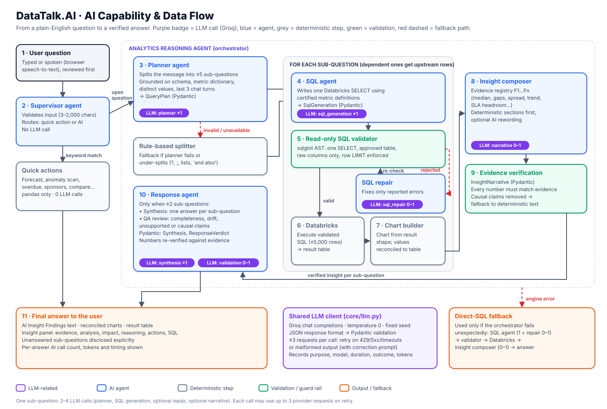

# DataTalk.AI — Healthcare Appeals Intelligence (POC)

DataTalk.AI is a Streamlit application that lets operations and compliance teams ask plain-English questions about a healthcare **Appeals & Grievances** portfolio and get back verified answers: a short finding, charts reconciled to the data, an evidence-linked insight panel, recommended actions and ready-to-edit Outlook drafts. Every number comes from a governed, read-only query against one Databricks table.

## Table of contents

1. [Project Overview](#1-project-overview)
2. [Problem Statement](#2-problem-statement)
3. [Objectives](#3-objectives)
4. [Features and Capabilities](#4-features-and-capabilities)
5. [Technology Stack](#5-technology-stack)
6. [Architecture and Repository Organization](#6-architecture-and-repository-organization)
7. [AI Capability and Data-Flow Diagram](#7-ai-capability-and-data-flow-diagram)
8. [AI Agents and Processing Workflows](#8-ai-agents-and-processing-workflows)
9. [LLM Usage and Call Accounting](#9-llm-usage-and-call-accounting)
10. [Question-Answer Cache](#10-question-answer-cache)
11. [Pydantic Schemas and Response Validation](#11-pydantic-schemas-and-response-validation)
12. [Prerequisites and Getting Started](#12-prerequisites-and-getting-started)
13. [Configuration Reference](#13-configuration-reference)
14. [Data, Assets, and Persistence](#14-data-assets-and-persistence)
15. [User Guide](#15-user-guide)
16. [Development and Maintenance Guide](#16-development-and-maintenance-guide)
17. [Testing and Verification](#17-testing-and-verification)
18. [Troubleshooting](#18-troubleshooting)
19. [Security, Privacy, and Limitations](#19-security-privacy-and-limitations)
20. [Future Improvements](#20-future-improvements)
21. [Quick Reference](#21-quick-reference)

---

## 1. Project Overview

| | |
|---|---|
| **Name** | DataTalk.AI (EXL proof of concept) |
| **What it is** | Conversational analytics plus four dashboards over a single appeals table in Databricks |
| **Who it is for** | Appeals operations leads, compliance managers, analysts, and the technical leads evaluating the POC |
| **Value** | Replaces the "ask an analyst → write SQL → build a chart → write it up" loop with one question, without letting the model invent numbers |

**Typical use cases:** "Which unit has the best turnaround?", "Overturn rate by provider specialty", "Which plan sponsors have the lowest compliance rate, and how is their volume trending?", a 6-month volume forecast, an anomaly scan, and month-over-month provider overturn comparisons. [`QA.txt`](QA.txt) holds the question bank used during development.

**POC scope:** one table, one LLM provider (Groq), a single Streamlit process, no authentication layer of its own, and no write access to any data.

## 2. Problem Statement

Appeals teams are measured against regulatory turnaround (SLA) and compliance targets. Leaders ask many ad-hoc questions about units, sponsors, providers and trends. Answering each one needs an analyst, a SQL query, a chart and a written explanation, so answers are slow and inconsistent, and dashboards only cover the questions someone anticipated.

**Why an AI approach fits:** an LLM can translate business language into SQL and phrase findings fluently. On its own it is not trustworthy with numbers, so this application uses the model only for *understanding, SQL drafting and wording* and keeps everything quantitative deterministic:

- SQL is validated by an AST allow-list before it runs.
- Charts are built in Python from the result and reconciled value-by-value.
- Insight text is built from an evidence registry; any AI sentence containing a number that is not in the evidence is discarded.

**Intended outcome and how to evaluate it:** correct answers to the question bank in `QA.txt` within seconds, with zero untraceable numbers. Useful measures are answer accuracy against hand-written SQL, the "Blocked claims" counter (AI sentences removed for unverifiable numbers), AI calls and tokens per answer (shown under every answer), and cache hit rate on repeated questions.

## 3. Objectives

**Primary (implemented)**

- Answer free-text appeals questions, including multi-part and dependent questions, from governed read-only SQL.
- Never show a number that cannot be traced to a query result or a documented calculation.
- Provide dashboards (Deep Dive, Intelligence, Risk & Findings, Data Explorer) and deterministic quick actions.

**Secondary (implemented)**

- Traceable LLM usage: every call is labelled, counted, timed and token-tracked.
- Reproducibility: temperature 0, fixed seed, deterministic prompt payloads, Pydantic-validated responses, bounded retries.
- Avoid repeat AI cost through a persistent question-answer cache.
- Professional light and dark themes; voice input; Outlook draft links.

**Future possibilities (not implemented)** — see [§20](#20-future-improvements): authentication and row-level permissions, multiple tables, semantic question matching, a shared cache store, and automated evaluation runs.

## 4. Features and Capabilities

| Area | What it does | Where it lives |
|---|---|---|
| **AI Assistant** | Natural-language questions → planner → governed SQL → verified insight. Handles up to 5 sub-questions, including dependent ones ("…then break *those* down by specialty"). | [`dashboards/ai_assistant.py`](dashboards/ai_assistant.py), [`agents/`](agents/) |
| **Quick actions** | 15 deterministic analyses with no LLM and no SQL: summary, top sponsors, task breakdown, overdue, escalated, by site, by unit, monthly trend, source/filer, risk overview, pending, reviewer segments, forecast, anomaly scan, two-value comparisons and provider overturn month-over-month. | [`core/fast_paths.py`](core/fast_paths.py) |
| **Insight panel** | Evidence tiles plus tabs for Detailed Analysis, Business Impact, AI Reasoning, Evidence, Recommended Actions, Data Considerations and SQL. Multi-question answers get one tab per question. | [`components/insight_panel.py`](components/insight_panel.py) |
| **Structured AI output** | Every LLM reply is parsed into a Pydantic model and retried (bounded) if it is malformed. | [`core/llm.py`](core/llm.py), agent modules |
| **Question-answer cache** | Successful AI answers are stored in `data/question_answer.json`; an identical question with the same data, configuration and context is answered with 0 AI calls. | [`core/qa_cache.py`](core/qa_cache.py) |
| **AI call tracking** | Per-answer and per-session counts of logical calls, provider requests, tokens, estimated cost and latency. | `core/llm.py`, header pills, caption under each answer |
| **Deep Dive** | 12 analysable dimensions, 10 cascading filters, click-to-drill, period comparison, heatmaps, leaderboards, CSV export. | [`dashboards/deep_dive_dashboard.py`](dashboards/deep_dive_dashboard.py) |
| **Intelligence** | Determination & sponsor analysis with 12 filters, open-case detail, trends, month-over-month sponsor growth, exports. | [`dashboards/intelligence_dashboard.py`](dashboards/intelligence_dashboard.py) |
| **Risk & Findings** | Risk index, ranked findings with owners, risk register, risk analytics, case watchlist, anomaly intelligence, Outlook drafts. | [`components/risk_findings.py`](components/risk_findings.py) |
| **Data Explorer** | Column picker, quick filters, 200-row preview, CSV export. | [`dashboards/data_explorer.py`](dashboards/data_explorer.py) |
| **Anomaly detection** | Seven statistical detectors with two-proportion z-tests and leave-one-out baselines. | [`anomaly_detection.py`](anomaly_detection.py) |
| **Voice** | Browser speech-to-text (reviewed before sending) and read-aloud. | [`speech_utils.py`](speech_utils.py) |
| **Outlook drafts** | Compose links with subject and body filled in; the app never sends mail. | [`components/outlook_mail.py`](components/outlook_mail.py) |
| **Themes and footer** | Native Streamlit light/dark themes, theme-neutral custom HTML, shared footer "Made and Designed by EXL India \| 2026". | [`.streamlit/config.toml`](.streamlit/config.toml), [`components/ui.py`](components/ui.py) |

**Interaction model:** the answer to a quick action can filter the dashboard population (e.g. *Overdue appeals* narrows every page to overdue cases). AI answers always query the full approved table; the dashboard filter does not change them.

## 5. Technology Stack

| Layer | Technology (locked version) | Role |
|---|---|---|
| Language | Python ≥ 3.12 (lock resolves for 3.12–3.15) | `.python-version` pins **3.13** for new environments |
| Package manager | **uv** (`pyproject.toml` + `uv.lock`) | Environments, dependency resolution, running commands |
| UI | Streamlit 1.66.0 | `st.navigation`/`st.Page`, `st.cache_data`/`st.cache_resource`, native light/dark themes |
| Charts | Plotly 7.1.0 | All visualisations (`theme="streamlit"` so text follows the active theme) |
| Data | pandas 3.0.6, NumPy 2.5.4 | Derived columns, KPIs, forecasting, statistics |
| Warehouse | databricks-sql-connector 4.7.0 | Read-only queries over a SQL warehouse |
| LLM | groq 0.37.1 (official SDK) | Chat completions with JSON response format |
| Default model | `openai/gpt-oss-20b` (`GROQ_MODEL`) | Overridable |
| Validation | Pydantic 2.14, pydantic-settings 2.x | AI response contracts and typed configuration |
| SQL safety | sqlglot 30.23 | AST validation of every generated statement |
| Cache file locking | filelock | Safe concurrent writes to the JSON cache |
| Voice | streamlit-mic-recorder 0.0.8 | Speech-to-text component |
| Dev tools | pytest, ruff (dependency group `dev`) | Tests, linting, import sorting |

`pyproject.toml` holds project metadata, dependencies, pytest and ruff configuration. `.streamlit/config.toml` holds the theme. There is no `requirements.txt`; uv is the only package manager.

There are no embeddings, vector stores or LangChain components in this application.

## 6. Architecture and Repository Organization

```
datatalk-ai/
├── app.py                         # Thin entry point: config, data load, header/KPIs, navigation, footer
├── prompts.py                     # Shared prompt blocks + PROMPT_VERSION
├── anomaly_detection.py           # Statistical anomaly detectors (pure pandas)
├── speech_utils.py                # Mic recorder + read-aloud
├── agents/
│   ├── supervisor_agent.py        # Routing: input check → quick action → QA cache → engine → fallback
│   ├── analytics_reasoning_agent.py  # Orchestrator: plan → SQL → execute → chart → insight → synthesis
│   ├── planner_agent.py           # LLM: split into sub-questions (QueryPlan)
│   ├── sql_agent.py               # LLM: SQL generation + repair (SqlGeneration)
│   ├── insight_generation_agent.py   # Evidence registry + optional LLM narrative (InsightNarrative)
│   ├── response_agent.py          # LLM: synthesis + QA review (Synthesis, ResponseVerdict)
│   └── visualization_agent.py     # Deterministic, reconciled charts (no LLM)
├── core/
│   ├── settings.py                # Settings (env/.env) + business rules + schema
│   ├── llm.py                     # Single LLM client, retries, Pydantic parsing, call tracking
│   ├── schemas.py                 # Shared enums + AssistantAnswer
│   ├── sql_guard.py               # Read-only validator + SQL executor (TTL result cache)
│   ├── data.py                    # Databricks load, derived columns, KPIs, grounding values
│   ├── fast_paths.py              # Deterministic quick actions, forecast
│   ├── qa_cache.py                # Persistent question-answer cache
│   ├── plot_style.py              # Theme-neutral Plotly styling + palettes
│   └── runtime.py                 # Streamlit caching wrappers + session state (only core module importing Streamlit)
├── components/
│   ├── ui.py                      # CSS, header, KPI cards, section labels, footer
│   ├── insight_panel.py           # Insight panel renderer
│   ├── risk_findings.py           # Risk & Findings page
│   ├── outlook_mail.py            # Outlook link helpers
│   └── visual_pipeline.py         # Defensive fallback charting
├── dashboards/
│   ├── ai_assistant.py            # Chat page
│   ├── deep_dive_dashboard.py     # Deep Dive page
│   ├── intelligence_dashboard.py  # Intelligence page
│   └── data_explorer.py           # Data Explorer page
├── data/question_answer.json      # Persistent QA cache (created/updated at runtime)
├── assets/ai_data_flow.svg        # AI data-flow diagram
├── tests/                         # pytest suite (no network)
├── .streamlit/config.toml         # Light/dark theme + client settings
├── pyproject.toml / uv.lock / .python-version / .env.example
└── QA.txt                         # Question bank
```

**How the pieces interact**

1. `app.py` loads settings, injects CSS, loads the dataset through `core.runtime.load_dataset()` (cached), renders the header and KPI cards, registers five pages with `st.navigation(position="top")`, runs the selected page and renders the footer.
2. The AI Assistant page passes each question to `Supervisor.answer()` (`agents/supervisor_agent.py`) with a `QuestionContext` (full dataset, grounding values, data fingerprint, recent chat).
3. The supervisor returns an `AssistantAnswer` (text, table, figures, insight, route, call accounting). The page renders it and stores it in the chat history.

**Where to make common changes**

| Task | Module |
|---|---|
| Business rules (SLA, aging, escalation) or approved columns | `core/settings.py` |
| A metric's SQL definition | `prompts.metric_dictionary()` (bump `PROMPT_VERSION`) |
| Planner / SQL / synthesis instructions | the matching module in `agents/` |
| A quick action | `core/fast_paths.py` (`FAST_QUERIES` + a branch in `run_fast_path`) |
| Chart rules for AI answers | `agents/visualization_agent.py` |
| Insight wording rules | `agents/insight_generation_agent.py` |
| Theme colours | `.streamlit/config.toml` (and accent in `components/ui.py`) |
| A new page | a module in `dashboards/` + one `st.Page` line in `app.py` |

**Design decisions**

- *Simple layers, no framework.* Agents are plain classes that receive their dependencies in the constructor; there is no registry or DI container.
- *Streamlit only at the edges.* `agents/` and most of `core/` have no Streamlit imports, so the AI workflow is unit-tested without a browser.
- *One LLM entry point.* All model calls go through `LLMClient.structured()`, which is where retries, JSON parsing, Pydantic validation and call tracking live.
- *Determinism first.* The model drafts; Python computes, validates and decides.

## 7. AI Capability and Data-Flow Diagram



**Processing path for an open question**

1. **User question** — typed, or spoken and reviewed before sending.
2. **Supervisor agent** — rejects empty or over-long input; deterministic quick actions are answered with pandas; everything else goes to the analytics engine.
3. **Planner agent (LLM)** — splits the message into up to five sub-questions with analysis type, grain, dimensions, metrics, filters and dependencies. If the call fails or returns an invalid plan, a rule-based splitter takes over; if the planner returns one sub-question but the splitter finds several, the splitter wins.
4. **SQL agent (LLM)** — writes one Databricks `SELECT` per sub-question using the certified metric dictionary and the grounding values. Dependent sub-questions receive up to 10 verified upstream rows.
5. **Read-only validator** — sqlglot AST check (single SELECT, approved table, raw columns only, enforced row LIMIT). On rejection the **SQL repair** call (LLM, at most once) fixes only the reported errors and is validated again.
6. **Databricks** executes the validated SQL (≤ 5,000 rows).
7. **Chart builder** chooses charts from the result shape and discards any chart whose plotted values are not in the table.
8. **Insight composer** builds an evidence registry (F1…Fn) and deterministic sections, then optionally asks the LLM to reword them.
9. **Evidence verification** validates the reply as `InsightNarrative`, removes sentences with untraceable numbers or causal claims, and falls back to deterministic text section by section.
10. **Response agent (LLM, multi-question only)** — synthesis produces one answer per sub-question; every number is re-verified against evidence. A QA review call reports unanswered or problematic sub-questions, which are disclosed in the answer.
11. **Final answer** — text, reconciled charts, result table, insight panel and the per-answer AI call count.

**Error paths:** provider errors and malformed output are retried inside the shared LLM client; if an agent still fails, its deterministic fallback is used (rule-based split, failure reason for the sub-question, deterministic insight, per-question synthesis text). If the orchestrator raises unexpectedly, the supervisor uses the **direct-SQL fallback** (SQL agent → validator → Databricks → insight composer).

## 8. AI Agents and Processing Workflows

| Agent | Module | LLM? | Input | Output |
|---|---|---|---|---|
| Supervisor | `agents/supervisor_agent.py` | No | question, `QuestionContext` | `AssistantAnswer` |
| Analytics reasoning (orchestrator) | `agents/analytics_reasoning_agent.py` | via sub-agents | question, grounding values, recent turns | `PipelineResult` |
| Planner | `agents/planner_agent.py` | `planner` | question, `as_of_date`, values, last 3 turns | `QueryPlan` → sub-question dicts |
| SQL | `agents/sql_agent.py` | `sql_generation`, `sql_repair` | sub-question, values, upstream rows | `SqlOutcome` (generation + validated SQL) |
| Insight generation | `agents/insight_generation_agent.py` | `insight_narrative` | result table, question, SQL | insight contract (dict rendered by the panel) |
| Response | `agents/response_agent.py` | `synthesis`, `response_validation` | outcomes of all sub-questions | `Synthesis`, `ResponseVerdict` |
| Visualization | `agents/visualization_agent.py` | No | result table | reconciled Plotly figures |

**Prompt ownership.** Each agent's system prompt lives in its own module (`build_system_prompt`, `REPAIR_SYSTEM_PROMPT`, `SYNTHESIS_SYSTEM_PROMPT`, `VALIDATOR_SYSTEM_PROMPT`, `DEFAULT_NARRATIVE_SYSTEM`). Text shared by several agents — the schema contract, the certified metric dictionary, JSON and grounding rules, and `user_payload()` — lives in [`prompts.py`](prompts.py) together with `PROMPT_VERSION`.

**Model configuration** comes from `core/settings.py`: model, temperature (0.0), seed (7), timeout, attempts and response format. User payloads are serialised with sorted keys so identical inputs produce identical prompts.

**Modifying an agent:** edit its prompt and/or Pydantic model in the same file, bump `PROMPT_VERSION` (this also invalidates cached answers), and run `uv run pytest`.

**Adding an agent:** create `agents/<name>_agent.py` with a Pydantic response model, a system prompt and a small class that takes a `StructuredLLM` and calls `llm.structured("<purpose>", system, payload, Model)`. Construct it in `AnalyticsEngine.__init__` and call it from `run()`. Add a test with `FakeLLM` (see `tests/conftest.py`) asserting the call count.

## 9. LLM Usage and Call Accounting

A **logical call** is one `LLMClient.structured()` invocation with a purpose label. A **provider request** is one HTTP request; a logical call makes 1 to `LLM_MAX_ATTEMPTS` (default 3) requests. The SDK's own retry loop is disabled so every request is counted.

| Purpose | Module | When it runs |
|---|---|---|
| `planner` | planner_agent | Once per AI question |
| `sql_generation` | sql_agent | Once per answerable sub-question |
| `sql_repair` | sql_agent | Only if the validator rejects the SQL and `ENABLE_SQL_REPAIR=true` |
| `insight_narrative` | insight_generation_agent | Per sub-question with a numeric result when `INSIGHT_LLM_NARRATIVE=true` |
| `synthesis` | response_agent | Only when the plan has ≥ 2 sub-questions |
| `response_validation` | response_agent | ≥ 2 sub-questions and `ENABLE_RESPONSE_VALIDATOR=true` |

**Calls per workflow** (N = number of sub-questions, max `MAX_SUB_QUESTIONS` = 5)

| Workflow | Logical LLM calls | Notes |
|---|---|---|
| Empty / too-long input, missing API key | 0 | Message only |
| Quick action (fast path) | 0 | pandas on the loaded dataset |
| Cache hit | 0 | Stored answer returned |
| Off-domain question | 1 | Planner returns `UNRELATED` |
| Single question, typical | **3** | planner → sql_generation → insight_narrative |
| Single question, range | 2–4 | −1 if narrative skipped (disabled or no numeric metric, or SQL failed), +1 for repair |
| N ≥ 2 sub-questions | 1 + N…3N + 2 | planner + per sub-question (1–3) + synthesis + validation (0–1) |
| N = 5, maximum | **17** | 1 + 5×3 + 1 + 1 |
| Direct-SQL fallback | +1 to +3 | after whatever the failed engine run consumed |

**Maximum provider requests** = logical calls × `LLM_MAX_ATTEMPTS` (e.g. 51 for the 17-call worst case with the default 3 attempts).

**Retry conditions** (inside `core/llm.py`): HTTP 408/409/425/429/5xx, connection and timeout errors (exponential back-off, honours "try again in Ns", capped at 15 s), malformed or schema-invalid JSON (re-asked with a short correction message), and Groq `json_validate_failed`. Other provider errors (e.g. 401) fail immediately.

**Not LLM calls:** SQL validation, Databricks queries and the SQL result cache, chart building, evidence verification, quick actions, anomaly detection, forecasting, and cache lookups. There are no embedding requests.

**Tracking metrics.** Each request is recorded as an `LLMCallRecord` (purpose, model, attempt, duration, outcome, tokens in/out, error type) and logged under the `datatalk.llm` logger without prompt or response content. Each answer's `meta` holds `llm_calls`, `llm_requests`, `calls_by_purpose`, tokens, `est_cost_usd`, route and elapsed time; the caption under every answer shows these. The header shows session totals.

**Uncertainty:** exact counts depend on runtime behaviour (how many sub-questions the planner returns, whether SQL needs repair, whether the result has a numeric metric). Token counts come from the provider's `usage` field; cost uses the estimate table in `core/settings.py` (`LLM_PRICING_PER_1M`) and must be updated to your rate card.

## 10. Question-Answer Cache

**Purpose:** answer an equivalent question already answered successfully without any AI call.

**File structure** (`data/question_answer.json`)

```json
{
  "cache_version": 1,
  "updated_at": "2026-10-20T15:00:00+00:00",
  "entries": {
    "<sha256 key>": {
      "question": "which unit has the most appeals",
      "created_at": "…",
      "model": "openai/gpt-oss-20b",
      "prompt_version": "2026.10.20-refactor.1",
      "fingerprints": {"ai": "…", "data": "…", "context": "…", "as_of_date": "2026-10-20"},
      "llm_calls_saved": 3,
      "answer": {"text": "…", "table": {"columns": [], "data": []}, "figures": [], "insight": {}}
    }
  }
}
```

**Normalisation:** Unicode NFKC, lower-case, surrounding quotes removed, whitespace collapsed, trailing `?`, `.`, `!` removed. Matching is **exact** on the normalised text; differently worded questions are not treated as equivalent.

**Key** = SHA-256 of the normalised question plus four fingerprints:

| Fingerprint | Changes when… |
|---|---|
| `ai` | model, temperature, seed, response format, table, engine switches, row limits, business rules, `PROMPT_VERSION` or `COMPOSER_VERSION` change |
| `data` | the loaded dataset changes (row count, closed count, latest closed date, grounding values) |
| `context` | the last three chat messages differ (follow-up questions depend on them) |
| `as_of_date` | the day changes (relative dates such as "last month") |

Any change produces a different key, so stale entries are never returned; they age out when the file exceeds `QA_CACHE_MAX_ENTRIES` (oldest first).

**Flow:** quick actions are handled first (they never touch the cache). Then the supervisor computes the key and checks the cache inside a per-key in-process lock. **Hit** → the stored answer is returned with `route="cache"`, `llm_calls=0`, and a "Served from the question-answer cache" badge. **Miss** → the AI workflow runs and the answer is stored only if it is cacheable.

**Bypassed (never stored):** partial answers (any sub-question unanswered or a blocking QA defect), fallback-path answers, unrelated questions, answers whose SQL is row-level (non-aggregate) or projects person-level/free-text columns outside an aggregate (`SENSITIVE_COLUMNS` in `core/settings.py`), questions containing long digit runs or e-mail addresses, answers larger than `QA_CACHE_MAX_ENTRY_KB`, and everything when `QA_CACHE_ENABLED=false`.

**Persistence and safety:** writes happen under a cross-process `filelock`, go to a temporary file and are moved into place with `os.replace` (retried briefly on Windows). The file is re-read when its modification time changes. A corrupt file is renamed to `question_answer.corrupt-<timestamp>.json` and a new cache is started; a different `cache_version` is discarded; individual invalid entries are dropped.

**Streamlit caching is separate:** `st.cache_data` holds the loaded table and the grounding profile (cleared by **Refresh data**); `st.cache_resource` holds the singletons (SQL executor, LLM client, engine, supervisor, cache object). `core/sql_guard.SqlExecutor` keeps a 5-minute in-memory SQL result cache. Clearing Streamlit caches does not delete stored answers; **Clear cached answers** in the sidebar does.

**Limitations:** identical questions arriving at the same moment in different server processes can both run the AI workflow (the lock is per process; the file lock only protects writes). Answers reflect the data snapshot at the time they were stored; refresh the data to change the fingerprint. Exact matching means rephrased questions miss.

## 11. Pydantic Schemas and Response Validation

| Schema | Module | Validated where | Consumed by |
|---|---|---|---|
| `QueryPlan`, `SubQuestion` | `agents/planner_agent.py` | planner reply | orchestrator DAG execution |
| `SqlGeneration`, `Measure` | `agents/sql_agent.py` | SQL generation and repair replies (must contain SQL when `answerable=true`) | validator, `ResultContract` |
| `InsightNarrative`, `NarrativeAction` | `agents/insight_generation_agent.py` | narrative reply | number/causal verification, insight panel |
| `Synthesis`, `SynthesizedAnswer` | `agents/response_agent.py` | synthesis reply | final multi-question text |
| `ResponseVerdict`, `Defect` | `agents/response_agent.py` | QA review reply | gap disclosure, cacheability |
| `Grain`, `Priority` | `core/schemas.py` | shared enums | planner, SQL, narrative |
| `AssistantAnswer` | `core/schemas.py` | built by the supervisor | UI, cache |
| `CacheEntry` | `core/qa_cache.py` | every stored entry when the file is read | cache |
| `Settings` | `core/settings.py` | at start-up | everything |

Enum-like fields accept harmless variations (case, spaces) through `field_validator`s but reject unknown values; there are no silent defaults for invalid content.

**Failure handling:** `LLMClient.structured()` extracts the first JSON object, validates it, and on failure re-asks with a compact list of field errors, up to `LLM_MAX_ATTEMPTS`. It then raises `LLMResponseError` (malformed) or `LLMUnavailableError` (provider). Each agent catches these and applies its documented fallback.

**Changing a schema safely:** keep fields the UI reads (see `components/insight_panel.py`); add new fields with defaults; update the matching prompt's response schema text; bump `PROMPT_VERSION`; add a test in `tests/test_fast_paths_and_schemas.py`. `LLM_RESPONSE_FORMAT=json_schema` sends the Pydantic JSON Schema to the provider (non-strict); the default `json_object` works across more models.

## 12. Prerequisites and Getting Started

**You need**

- **uv** 0.9 or newer (developed with 0.13). Install: <https://docs.astral.sh/uv/getting-started/installation/>
- **Python** 3.12+ (uv installs 3.13 automatically from `.python-version` if missing).
- A **Databricks SQL warehouse**, its hostname, HTTP path and an access token with `SELECT` on the appeals table (see [§14](#14-data-assets-and-persistence) for required columns).
- A **Groq API key** (only needed for AI answers; dashboards and quick actions work without it).
- Chrome or Edge for voice features.

**Steps**

```bash
# 1. Get the code
git clone <your-repository-url> datatalk-ai     # or unzip the delivered archive
cd datatalk-ai

# 2. Create the environment and install the locked dependencies (incl. dev tools)
uv sync

# 3. Configure
cp .env.example .env            # Windows PowerShell: Copy-Item .env.example .env
# edit .env: DATABRICKS_SERVER_HOSTNAME, DATABRICKS_HTTP_PATH, DATABRICKS_ACCESS_TOKEN,
#            DATABRICKS_CATALOG / DATABRICKS_SCHEMA / DATABRICKS_TABLE, GROQ_API_KEY

# 4. Run
uv run streamlit run app.py
```

Open **<http://localhost:8501>**. The first load runs one full-table query; allow time for large tables.

`uv sync` installs exactly what `uv.lock` records. Use `uv sync --frozen` in CI to fail instead of updating the lock, and `uv sync --no-dev` for a runtime-only environment.

## 13. Configuration Reference

Precedence: real environment variables → `.env` in the project root → defaults in `core/settings.py`. Restart the app after editing `.env`. **Secrets** are marked 🔒 and are held as `SecretStr` (never printed).

| Variable | Default | Required | Purpose |
|---|---|---|---|
| `DATABRICKS_SERVER_HOSTNAME` | — | Yes | Workspace hostname |
| `DATABRICKS_HTTP_PATH` | — | Yes | SQL warehouse HTTP path |
| `DATABRICKS_ACCESS_TOKEN` 🔒 | — | Yes | Access token |
| `DATABRICKS_CATALOG` | empty | No | Used only together with schema |
| `DATABRICKS_SCHEMA` | empty | No | Two- or three-part table name |
| `DATABRICKS_TABLE` | `appeals_final` | No | The only queryable table |
| `DATA_CACHE_TTL_SECONDS` | `0` | No | 0 = keep the loaded table until **Refresh data** |
| `GROQ_API_KEY` 🔒 | — | For AI | Groq credential |
| `GROQ_MODEL` | `openai/gpt-oss-20b` | No | Model id |
| `LLM_TEMPERATURE` | `0.0` | No | Generation temperature (narrative included) |
| `LLM_SEED` | `7` | No | Provider seed for reproducibility (best effort) |
| `LLM_TIMEOUT_SECONDS` | `45` | No | Per-request timeout |
| `LLM_MAX_ATTEMPTS` | `3` | No | Requests per logical call (1–5) |
| `LLM_RETRY_BASE_SECONDS` | `1.0` | No | Back-off base |
| `LLM_RESPONSE_FORMAT` | `json_object` | No | or `json_schema` |
| `MAX_ROW_QUERY_LIMIT` | `200` | No | LIMIT forced on row-level SQL |
| `MAX_RESULT_ROWS` | `5000` | No | Hard cap on rows fetched for generated SQL |
| `SQL_CACHE_TTL_SECONDS` / `SQL_CACHE_MAX_ENTRIES` | `300` / `64` | No | In-memory SQL result cache |
| `PROMPT_MAX_VALUES_PER_FIELD` | `25` | No | Grounding values per field sent to the LLM |
| `MAX_SUB_QUESTIONS` | `5` | No | Upper bound of the plan |
| `MAX_PARALLEL_WORKERS` | `1` | No | Threads for independent sub-questions |
| `ENABLE_SQL_REPAIR` | `true` | No | Allow the repair call |
| `ENABLE_RESPONSE_VALIDATOR` | `true` | No | Allow the QA review call |
| `INSIGHT_LLM_NARRATIVE` | `true` | No | Allow AI rewording of insights |
| `QA_CACHE_ENABLED` | `true` | No | Persistent cache on/off |
| `QA_CACHE_PATH` | `data/question_answer.json` | No | Relative paths resolve from the project root |
| `QA_CACHE_MAX_ENTRIES` / `QA_CACHE_MAX_ENTRY_KB` | `500` / `768` | No | Size limits |
| `INSIGHT_MAIL_CLIENT` | `outlook_web` | No | or `desktop` (mailto:) |
| `INSIGHT_MAIL_CC` | empty | No | Pre-filled CC |
| `LOG_LEVEL` | `INFO` | No | `datatalk.*` loggers |

**Code-level constants** in `core/settings.py`: `SLA_DAYS=30`, `AGING_THRESHOLD=60`, `ESCALATION_LEVEL=2`, `RAW_COLUMNS`, `DERIVED_COLUMNS`, `SENSITIVE_COLUMNS`, `LLM_PRICING_PER_1M`. **Theme** in `.streamlit/config.toml` (`[theme]`, `[theme.light]`, `[theme.dark]`).

## 14. Data, Assets, and Persistence

**Source table (static input).** One Databricks table with these raw columns (the only ones allowed in SQL): Case Identifier, Level Type Code, Case Type Code, Case Item Level Posted Date Timestamp, Behalf Of, Closed In Compliance Indicator, Current Unit Name, Current User Name, Posted Date, Posted Time, Received Date, Work Item Status Short Name, Work Item Task Short Name, Routed Timestamp, Routed To Business Unit Name, Routed To Dept Name, Routed To Site Name, Routed To User ID, Routed To User Name, Routed To User Segment Code, Routed To User Segment Description, Routing Comments Text, Transferred By User Identifier, Transferred By User Name, Transferred To User Identifier, Transferred To User Name, Closed Date (CaseHistory), Case Decision Maker ID, Pre Post Source Code, ASO Grouping, Plan Sponsor Name, Determination, Case Status, Provider_ID, Provider_Name, Provider_Type, Provider_Specialty, Network_Status.

**Derived columns** (pandas only, `core/data.enrich`): `IsClosed`, `CaseAgeDays`, `OpenAgingDays`, `IsCompliant`, `IsOverdue` (age > SLA), `IsEscalated`, `IsTransferred`, `ComplianceStatus`, `ComplianceRiskScore` (0.05 + 0.30·non-compliant + 0.25·overdue + 0.25·escalated + 0.15·transferred, clipped 0.01–0.99), determination flags, month/quarter/year, provider columns with spaces, and labels. The SQL validator rejects them in generated SQL.

**Files**

| File | Kind | Notes |
|---|---|---|
| `data/question_answer.json` | Modified at runtime | Persistent QA cache; ships empty |
| `data/question_answer.json.lock`, `*.tmp`, `*.corrupt-*.json` | Generated | Lock/temporary/quarantine files (git-ignored) |
| `assets/ai_data_flow.svg` | Static | AI data-flow diagram |
| `QA.txt` | Static | Question bank |
| `.env` | Local, secret | Never commit (git-ignored) |

**Reset the cache:** sidebar → **Clear cached answers**, or stop the app and replace the file with `{"cache_version": 1, "entries": {}}`. **Privacy:** cached answers contain aggregate tables, chart data and insight text; row-level and person-level answers are not stored (see [§10](#10-question-answer-cache)). Treat the file as internal data nonetheless.

## 15. User Guide

**Layout.** Header (live status pills: DB latency, model, AI calls, tokens, estimated cost, cache hits, average answer time, blocked claims) → six KPI flip cards (hover for baseline and delta) → top navigation: **AI Assistant · Deep Dive · Intelligence · Risk & Findings · Data Explorer** → page → footer. The collapsed sidebar has **Refresh data**, cache statistics, **Clear cached answers** and the business rules.

**Asking a question.** Type into the chat box (or click 🎙️, review the transcript, then **➤ Send**). The status box shows each stage. Quick-action buttons run deterministic analyses; *More quick actions* has the rest. **🗑️ New chat** clears history and resets the dashboard population.

**Reading an answer.** *AI Insight Findings* is the direct answer; charts follow; **🔊 Listen** reads it aloud; the insight panel has Detailed Analysis, Business Impact, AI Reasoning, Evidence (F-numbers), Recommended Actions (each with **Draft in Outlook**), Data Considerations and the exact SQL; *View result data* shows the verified table. The caption at the bottom shows the route, AI calls by purpose, tokens, cache status and time. Cached answers carry a "Served from the question-answer cache — no AI calls" badge.

**Tips.** Name real values (units, sites, sponsors); separate questions with `?`, `;`, "and also" or a numbered list; state the period; avoid quick-action phrases (e.g. "forecast", "anomaly") if you want the SQL engine.

**Dashboards.** *Deep Dive*: pick *Analyze By* / *Break Down By*, use the filters, click a bar to cross-filter, export. *Intelligence*: set the 12 filters; everything below updates. *Risk & Findings*: scope, dimension, risk index, findings, register, analytics, watchlist, anomaly scan. *Data Explorer*: choose columns, filter, download.

**Light / dark mode.** ⋮ menu (top right) → **Settings** → *Theme* → Light, Dark or "Use system setting". Both themes are defined in `.streamlit/config.toml`; cards, charts and the footer follow the active theme.

## 16. Development and Maintenance Guide

**Dependencies (uv)**

```bash
uv add <package>             # runtime dependency (updates pyproject.toml and uv.lock)
uv add --dev <package>       # dev-only
uv lock --upgrade            # refresh all locked versions within constraints
uv lock --upgrade-package streamlit
uv sync                      # apply the lock to .venv
```

Commit `pyproject.toml` and `uv.lock` together.

**Quality commands**

```bash
uv run pytest                # tests
uv run ruff check .          # lint (rules in pyproject.toml)
uv run ruff check . --fix    # auto-fix (incl. import order)
```

There is no separate type checker configured; type hints are used throughout and Pydantic validates the runtime contracts.

**Prompts and models.** Edit agent prompts in their modules, shared blocks in `prompts.py`, then bump `PROMPT_VERSION`. Model and generation settings are environment variables (§13).

**Logging.** `core.runtime.configure_logging()` attaches one handler to the `datatalk` logger (`LOG_LEVEL`). Logged: LLM call metadata, SQL row counts and durations, cache events, fallbacks and exceptions with tracebacks. Not logged: prompts, model output, query results or secrets.

**Error handling.** Agents catch only `LLMResponseError`/`LLMUnavailableError` and apply their fallback; the orchestrator isolates each sub-question; the supervisor falls back to direct SQL; the chat page catches anything left, shows a generic message and logs the traceback.

**Keeping it simple.** New features belong in the existing folder that owns the responsibility (agents for AI steps, `core/` for logic without UI, `components/` for reusable UI, `dashboards/` for pages). Prefer a function or a small class over new layers.

## 17. Testing and Verification

| Test file | Covers |
|---|---|
| `tests/test_llm_client.py` | JSON extraction, schema-invalid retry with correction, attempt limit, rate-limit retry, non-transient fail-fast, missing key, call tracking |
| `tests/test_engine_call_accounting.py` | Exact LLM call sequences: single question (3), two questions (7), repair (+1), repair disabled, unrelated (1), narrative disabled (2), planner fallback, invented numbers removed |
| `tests/test_supervisor_and_cache.py` | Cache miss → hit with 0 new LLM calls and no SQL, fingerprint invalidation, row-level bypass, fast path with 0 calls, missing key, cache disabled, direct-SQL fallback, corrupt file, version mismatch, serialisation round-trip, normalisation, PII detection |
| `tests/test_fast_paths_and_schemas.py` | Every quick-action trigger, comparison and provider MoM, Pydantic validation and coercion, rule-based split, deterministic composer |
| `tests/test_sql_guard.py` | Read-only validator rules, LIMIT enforcement, sensitive projection, executor cache and row cap |
| `tests/test_app_smoke.py` | Headless `AppTest`: app renders header, KPIs and footer; a quick action answers with 0 AI calls; each dashboard page renders |

The suite needs **no credentials and no network**: Databricks is replaced by a synthetic dataset (`tests/conftest.py`) and the LLM by `FakeLLM`, which records calls in the same trace as the real client.

**Verification performed for this version**

- `uv run pytest` → **68 passed**.
- `uv run ruff check .` → **All checks passed**.
- `uv run streamlit run app.py --server.headless true` started and `/_stcore/health` returned `ok` (no Databricks credentials, so the page showed the configuration error).
- `.streamlit/config.toml` parsed by `streamlit config show`.
- `assets/ai_data_flow.svg` parsed as XML, rendered to PNG for review, and contains no cache-related content.

**Not verified:** live Databricks queries, live Groq calls and model output quality, and visual review of both themes in a real browser — these need credentials and a browser that were not available.

## 18. Troubleshooting

| Symptom | Cause | Fix |
|---|---|---|
| `uv sync` fails to download Python | No access to python-build-standalone | Install Python 3.12+ yourself and run `uv sync --python 3.12` |
| "Could not load the appeals data: Databricks credentials missing" | `.env` missing or empty values | Copy `.env.example` to `.env` in the project root; set the three `DATABRICKS_*` values; restart |
| Load error mentioning table/columns | Wrong catalog/schema/table, missing grant, stopped warehouse | Check names, `GRANT SELECT`, start the warehouse; compare columns with §14 |
| "The AI assistant is not configured" | `GROQ_API_KEY` missing | Add it and restart; quick actions keep working |
| "The AI service could not generate a query…" | Provider unavailable, 401, or repeated malformed output | Check the key and model; look for `llm_call … outcome=` lines in the log |
| Slow answers / `rate_limited` in logs | Groq rate limits | Keep `MAX_PARALLEL_WORKERS=1`, lower `PROMPT_MAX_VALUES_PER_FIELD`, raise `LLM_MAX_ATTEMPTS` |
| "blocked by the SQL safety policy" | Model used a derived column or another table | Usually repaired automatically; confirm `ENABLE_SQL_REPAIR=true` and `DATABRICKS_TABLE` |
| "Result exceeded the safe limit" | More than `MAX_RESULT_ROWS` rows | Ask for an aggregate or add filters |
| Answer seems stale | Cache entry from an earlier data snapshot | **Refresh data** (changes the data fingerprint) or **Clear cached answers** |
| `question_answer.corrupt-*.json` appeared | The cache file was unreadable | Already recovered automatically; delete the quarantine file after review |
| Question took a quick-action path | Contains a trigger phrase (e.g. "forecast") | Rephrase |
| Voice button does nothing | Browser blocked the microphone | Use Chrome/Edge on `localhost` or HTTPS and allow microphone access |
| Theme looks unchanged | Browser preference set to system | ⋮ → Settings → Theme |

## 19. Security, Privacy, and Limitations

- **Credentials** come from the environment or `.env` (git-ignored) and are typed as `SecretStr`; they are never logged or shown.
- **Read-only access:** generated SQL must pass the AST allow-list (single SELECT, one table, raw columns, no comments or mutation keywords). The token should still have only `SELECT` permission.
- **Data sent to the LLM:** the question, schema and metric definitions, a capped list of distinct categorical values, the last three chat messages, and for narrative/synthesis the evidence values derived from query results (dependent sub-questions also receive up to 10 upstream result rows). Row-level questions can therefore put case-level values into a prompt. Review this against your PHI/PII policy before use with real data.
- **Logs** contain call metadata only; no prompts, responses or results.
- **Cache file** stores aggregate answers locally; row-level, person-level and identifier-containing questions are excluded, but the file should be treated as internal data.
- **No authentication or per-user permissions** are implemented; anyone who can reach the app sees all data, and the cache is shared by all users of the server.
- **Reliability:** depends on Groq and Databricks availability; the LLM can misinterpret a question even when every shown number is verified — check the SQL tab for important decisions.
- **Analytics caveats:** the pandas `IsOverdue` (any case older than the SLA) differs from the SQL metric `overdue_appeals` (open cases older than the SLA); the forecast is linear; the risk score and register weights are heuristics.

This POC makes no compliance or production-readiness claims.

## 20. Future Improvements

**Current limitations (confirmed):** single table and provider; no authentication; process-local duplicate-question lock; exact-match cache only; the full table is loaded into memory; overdue definition mismatch noted above; no automated answer-quality evaluation.

**Optional enhancements:** SSO and row-level security (would also require per-user cache keys); a shared cache/store (e.g. Delta table) for multi-instance deployment; semantic question matching with a similarity threshold and review; pushdown aggregation for dashboards on large tables; a scheduled evaluation over `QA.txt` with expected SQL; aligning the pandas and SQL overdue definitions; seasonal forecasting.

**Before production:** security review of data sent to the LLM, secret management, monitoring and alerting on `datatalk.*` logs, load testing with real data volumes, and accessibility testing in both themes.

## 21. Quick Reference

```bash
uv sync                                   # install
cp .env.example .env                      # configure
uv run streamlit run app.py               # run → http://localhost:8501
uv run pytest                             # tests
uv run ruff check .                       # lint
uv add <pkg> / uv lock --upgrade          # dependencies
```

| Item | Location |
|---|---|
| Entry point | `app.py` |
| Settings and business rules | `core/settings.py`, `.env` |
| LLM client and call tracking | `core/llm.py` |
| Routing / cache use | `agents/supervisor_agent.py` |
| AI orchestrator | `agents/analytics_reasoning_agent.py` |
| Prompts | `agents/*_agent.py`, shared blocks in `prompts.py` |
| Quick actions | `core/fast_paths.py` |
| QA cache | `core/qa_cache.py`, `data/question_answer.json` |
| Theme / footer | `.streamlit/config.toml`, `components/ui.py` |
| Diagram | `assets/ai_data_flow.svg` |

Key variables: `DATABRICKS_SERVER_HOSTNAME`, `DATABRICKS_HTTP_PATH`, `DATABRICKS_ACCESS_TOKEN`, `DATABRICKS_TABLE`, `GROQ_API_KEY`, `GROQ_MODEL`, `QA_CACHE_ENABLED`, `LLM_MAX_ATTEMPTS`.

---

Made and Designed by EXL India | 2026
